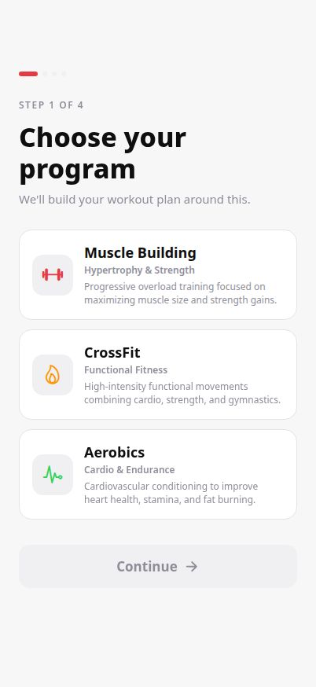
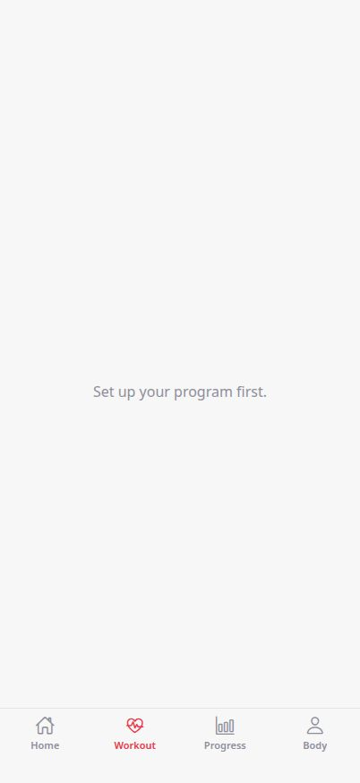
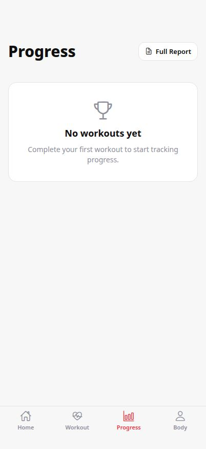
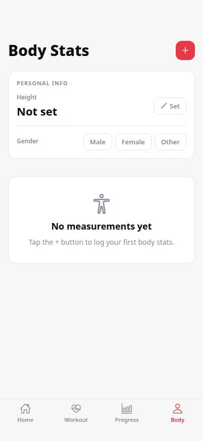

# RecordFit — Personal Fitness Tracker

A full-featured iOS fitness tracker app built with Expo / React Native. Track workouts, log body measurements, monitor strength progression, and view detailed progress reports — all stored privately on-device with no account required.

## Features

- **Program Selection** — Choose from Muscle Building, CrossFit, or Aerobics programs
- **Auto-generated Workout Plans** — Customizable by days per week and session duration
- **Exercise Logging** — Sets, reps, and weight tracking with last-used weight auto-fill
- **Bodyweight Exercise Support** — Reps-only tracking for push-ups, pull-ups, etc.
- **Calorie Estimation** — MET-based estimates using body weight, duration, program type, and gender
- **Progress Tracking** — Weekly charts, streak tracking, total calories, avg sessions/week
- **Strength Progression** — Per-exercise bar charts and personal records
- **Body Measurements** — Weight, BMI, chest, waist, hips, arms, thighs with SVG trend charts
- **Full Progress Report** — All stats consolidated in one scrollable report screen
- **Fully Private** — All data stored on-device via AsyncStorage, no account or internet required

## Screenshots

| Home | Workout | Progress | Body |
|---|---|---|---|
|  |  |  |  |

## Stack

- **Expo SDK 54** with expo-router v6
- **React Native** (iOS-first)
- **AsyncStorage** for local persistence
- **expo-haptics**, **expo-linear-gradient**, **react-native-svg**
- **TypeScript**

## Getting Started

```bash
# Install dependencies
pnpm install

# Start the development server
pnpm --filter @workspace/fitness-tracker run dev
```

Then scan the QR code with the **Expo Go** app on your iPhone.

## Project Structure

```
artifacts/fitness-tracker/
├── app/
│   ├── (tabs)/
│   │   ├── index.tsx        # Home dashboard
│   │   ├── workout.tsx      # Workout session screen
│   │   ├── progress.tsx     # Progress charts & stats
│   │   └── body.tsx         # Body measurements
│   ├── progress-report.tsx  # Full-screen progress report
│   ├── onboarding.tsx       # 4-step setup flow
│   └── settings.tsx         # App settings
├── context/
│   └── AppContext.tsx        # Global state (profile, logs, body entries)
├── constants/
│   ├── workouts.ts          # Exercise library & program definitions
│   └── calories.ts          # MET-based calorie estimation
└── app.json                 # Expo config
```

## App Store

Available on the Apple App Store as **RecordFit**.

[](https://apps.apple.com/app/id6776657014)

**Direct link:** https://apps.apple.com/app/id6776657014
